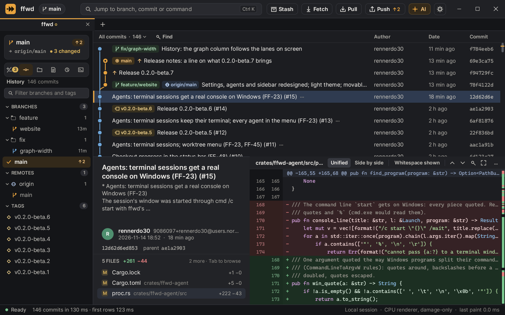
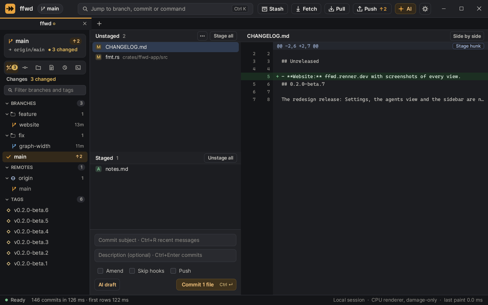
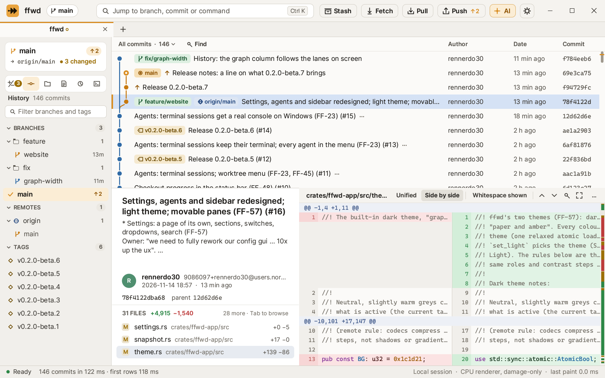

<p align="center"><picture>
  <source media="(prefers-color-scheme: dark)" srcset="assets/logo/ffwd-wordmark.svg">
  
</picture></p>

<p align="center"><b>A Git client that is fast at everything, everywhere, including over remote desktop.</b><br>
Windows · macOS · Linux · written in Rust</p>

<p align="center"><a href="https://ffwd.renner.dev"><b>ffwd.renner.dev</b></a> · <a href="https://github.com/rennerdo30/ffwd/releases">Download</a> · <a href="CHANGELOG.md">Changelog</a></p>

---

**Status: beta.** ffwd is good for daily work: history, staging and committing, branches, merge and rebase, conflicts, stashes, remotes and more are built. Some features are still on the way; the [feature list](docs/FEATURES.md) says which.



*Every image here is the real UI, rendered offscreen by `ffwd --snapshot`; none is a mock-up. More in [Screenshots](docs/SCREENSHOTS.md).*

## Why

Desktop Git clients are often slow. They render late, stutter on big repositories and turn sluggish over remote desktop. ffwd is built the other way round:

- **The first frame comes first.** The window and chrome are on screen in about 22 ms (median, release build), and history streams in behind them.
- **Input answers in the same frame.** Selecting a commit shows its header immediately; files and diff follow.
- **Nothing blocks the UI.** Every Git call, file read and network request runs on a worker thread.
- **It is built for remote desktop.**
  - There is no frame loop and nothing is drawn at idle.
  - Each present sends only what changed.
  - Scrolling moves pixels instead of repainting them.
  - The CPU renderer is a complete backend, so sessions without a GPU stay fast.
- **Your work is safe.** Destructive actions ask first and name what would be lost; the reflog view brings lost commits back.
- **AI on your terms.** Commit messages from an endpoint you choose, preferably a local model server. It is off until you configure it, and you see exactly what is sent.

| Local changes | Side by side |
|---|---|
|  |  |

## Install

Download the newest release from [ffwd.renner.dev](https://ffwd.renner.dev) or the [releases page](https://github.com/rennerdo30/ffwd/releases):

- **Windows:** `ffwd-<version>-setup.exe`, a per-user setup (no admin rights) that updates itself, or the portable zip.
- **macOS** (Apple silicon) and **Linux** (x86_64): `.tar.gz` archives.

Details and checksums: [Installing ffwd](docs/INSTALL.md).

## Build from source

You need Rust (the toolchain installs itself from `rust-toolchain.toml`) and Git. On Windows, double-click or run the scripts:

| Script | What it does |
|---|---|
| `scripts\run.bat [repo] [--release] [--pull] [--trace]` | Build and open ffwd on a repository (this one by default) |
| `scripts\snapshot.bat [repo] [--select N] [--focus diff] [--palette Q]` | Render the UI offscreen to `artifacts\snapshot.png` and open it |
| `scripts\bench-startup.bat [repo] [runs]` | Measure startup in a hidden window, one JSON line per run |
| `scripts\check.bat` | The CI checks: format, clippy, tests |
| `scripts\package.bat` | Build the Windows setup, the zip and `SHA256SUMS.txt` into `artifacts\installer` |

On macOS and Linux: `scripts/run.sh` and `scripts/check.sh`, or `cargo run --release -- path/to/a/repo`.

| Key | Action |
|---|---|
| `↑ ↓` / `j k` | Move through history, files or diff |
| `Tab` / `Shift+Tab` | Switch between history, files and diff |
| `Ctrl+K` / `Ctrl+P` / `/` | Jump to a branch, tag or SHA, or find a command |
| `Ctrl+O` / `Ctrl+T` | Open another repository in a tab |
| `Ctrl+Tab` / `Ctrl+W` | Next tab / close tab |
| `Ctrl+Shift+F` / `L` / `K` | Fetch / Pull / Push |
| `Esc` | Back to history |

Offscreen rendering and startup traces:

```sh
ffwd path/to/repo --snapshot shot.png --size 1600x1000 --select 3
FFWD_TRACE=1 ffwd path/to/repo
```

## Project

- [Specification and speed budgets](docs/SPEC.md)
- [UI design](docs/UI-DESIGN.md)
- [Feature plan](docs/FEATURES.md)
- [Screenshots](docs/SCREENSHOTS.md)
- [Website](website/README.md)
- [Building and fast iteration](docs/BUILD.md)
- [Releasing and updates](docs/RELEASING.md)
- [Architecture decisions](docs/decisions)
- [Contributor and agent rules, including the performance rules](AGENTS.md)

License: [MIT](LICENSE).
