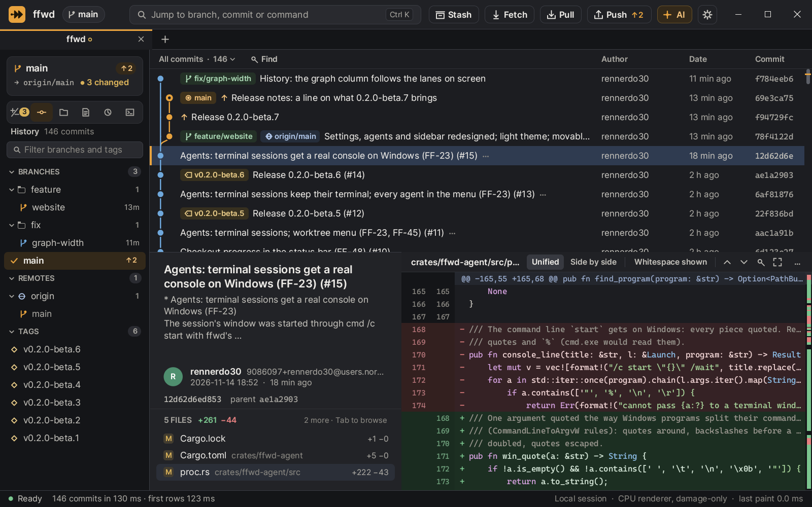
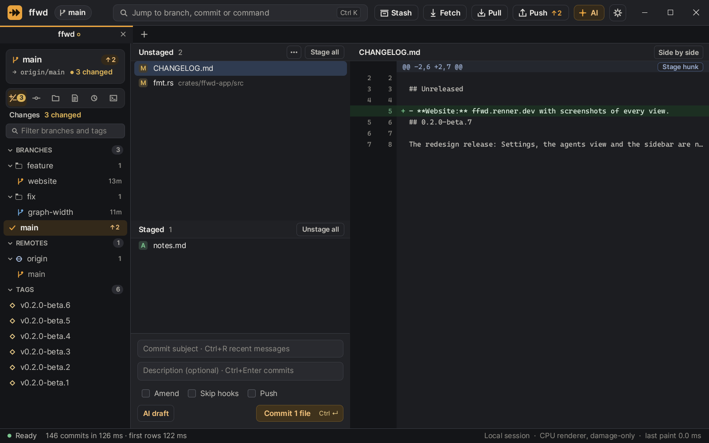
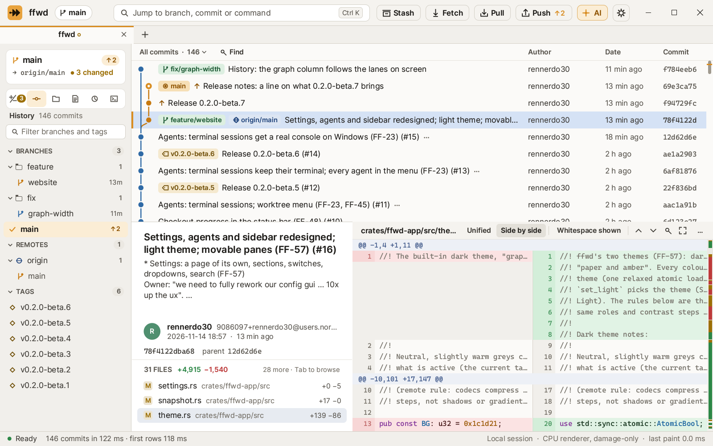
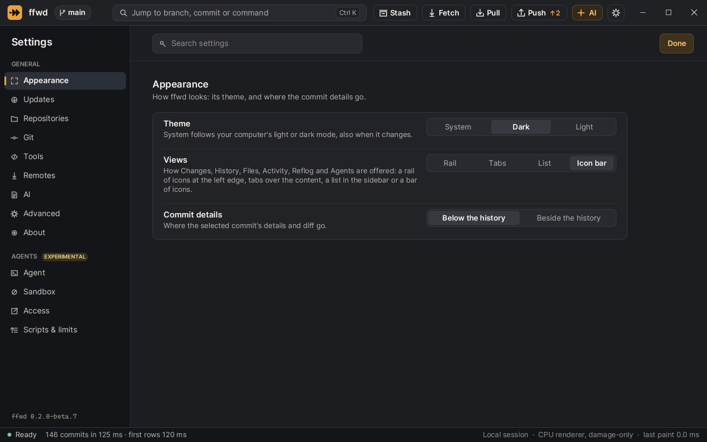

# Screenshots

Every image in the README, these docs and on [ffwd.renner.dev](https://ffwd.renner.dev) is the real UI. `ffwd --snapshot` renders it offscreen with the same code that paints the window. Nothing is drawn by hand or retouched.

## History



Labels show the checked-out branch, local and remote branches and tags. Commits ahead of the upstream carry an ↑. The sidebar's card says where you are: the branch, ahead or behind its upstream, and how many files changed.

## Local changes



Stage whole files, hunks or single lines. The commit box has Amend, Skip hooks, Push after commit and an AI draft.

## Side by side, light theme



Diffs show unified or side by side, with syntax colours and word highlights. The scrollbar marks every change.

## Settings



## How they are made

The images come from version 0.2.0-beta.7, at 1600 × 1000 pixels and 125 % scale, in a throwaway clone of this repository with a few local edits:

```sh
ffwd <clone> --snapshot history-dark.png --size 1600x1000 --scale 1.25 --theme dark --select 4 --file 3
ffwd <clone> --snapshot changes-dark.png --size 1600x1000 --scale 1.25 --theme dark --changes
ffwd <clone> --snapshot diff-light.png   --size 1600x1000 --scale 1.25 --theme light --select 3 --diff-split --file 8
ffwd <clone> --snapshot settings-dark.png --size 1600x1000 --scale 1.25 --theme dark --settings --settings-section Appearance
```

The website uses the same captures as WebP, in both themes (`website/assets/shots/`). To refresh them, render again with the release you are showing and convert the PNGs:

```sh
ffmpeg -i history-dark.png -c:v libwebp -quality 88 history-dark.webp
```

Use a clone with no personal paths, other worktrees or secrets in it. Every screenshot is public.
