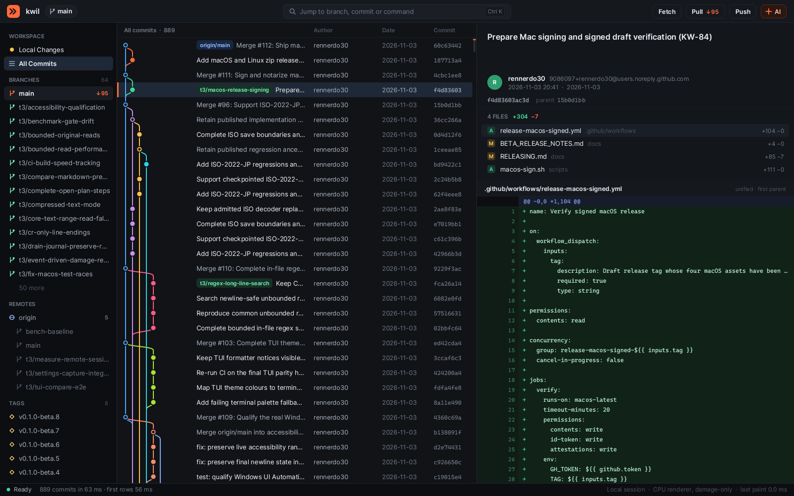

# UI design

Status: first design, shown in the proof of concept (2026-11-13).



The capture above is the real PoC UI. `ffwd --snapshot` rendered it offscreen from the Kwil repository, using the same paint code that the window uses.

## Layout

```
┌ top bar ──────────────────────────────────────────────────────────────────┐
│ ▶▶ repo  ⑂ branch      [ Jump to branch, commit or command   Ctrl K ]  Fetch Pull↓ Push↑ AI │
├ sidebar ──┬ history ───────────────────────────────┬ details ─────────────┤
│ WORKSPACE │ graph │ refs · subject │ author │ date │ sha │ subject, body  │
│ BRANCHES  │                                        │ author, date, SHA    │
│ REMOTES   │  virtualised rows, one per commit      │ FILES (status, +/−)  │
│ TAGS      │                                        │ diff of the file     │
│ STASHES   │                                        │                      │
├───────────┴────────────────────────────────────────┴──────────────────────┤
│ ● state · measured timings                     session · renderer · paint │
└───────────────────────────────────────────────────────────────────────────┘
```

- **The top bar holds one input for everything:** branches, tags, SHAs and commands, with `Ctrl+K`, `Ctrl+P` or `/`. actions (Fetch, Pull, Push) stay visible with live ahead/behind counts. The AI button is the single entry point to AI features.
- **The sidebar is the map, not a second list.**
  - Local Changes shows a count badge.
  - The current branch is marked in the accent colour and shows its ahead/behind counts.
  - Remotes, tags, stashes and worktrees are grouped, and long sections end in "N more".
- **The history list shows:**
  - the graph;
  - ref chips: the current branch in accent, local in green, remote in blue, tags in amber;
  - the subject, with a "…" marker when the commit has a body;
  - the author, a relative date and a short SHA.
  The selected row has a 3 px accent bar, and the scroll track marks where the selection is.
- **The details pane has three layers that arrive at different times.** The header (subject, author, date, SHA, parents) paints in the same frame as the selection, from the history row. The body, the files and the diff fill in behind it. Placeholders are solid, still bars, never spinners.
- **The status bar tells the truth:** what is loading, real measured timings, the session type (local or remote) and the renderer.

## Window frame

- **Windows 11:** the top bar is the title row, the way Explorer, Settings and Terminal look. ffwd draws minimise, maximise/restore and close with Windows 11 metrics (46 px wide, red close hover). The maximise button reports itself as `HTMAXBUTTON`, so hovering it opens Snap Layouts. The empty parts of the bar drag the window and double-click maximises; side, bottom and top resize edges stay native (`crates/ffwd-app/src/frame.rs`, the same approach as Ferrow).
- **macOS:** a transparent, full-size title bar; the native traffic lights sit over the left of the bar, which leaves room for them.
- **Linux:** server-side decorations from the desktop.
- **Icon:** the window icon is drawn from the logo's geometry at startup; `ffwd --icon-png out.png 256` writes it as a PNG for packaging.

## Sidebar

- Sections: Workspace (Local Changes, All Commits), Branches, Remotes, Tags, Stashes, Worktrees. Every section, remote and branch folder (`t3/…`) folds open and closed; the state is remembered.
- The sidebar keeps **its own selection**: clicking a branch or tag highlights it there and jumps the history to its commit. Choosing a branch in `Ctrl+K` selects it in the sidebar too.
- The checked-out branch has a check mark; ahead/behind counts sit on the right.
- A filter field at the top narrows branches, remotes, tags and stashes (folders open while filtering). Typing while the sidebar has focus starts filtering.
- Keyboard: `Tab` cycles sidebar → history → files → diff; in the sidebar `↑ ↓`, `←` closes or goes to the parent, `→` opens, `Enter` jumps.

## Local Changes (FF-35)

**Local Changes** in the sidebar replaces the history and details with the working tree. **All Commits**, or jumping to any ref, shows history again.

- **Left column:**
  - **Unstaged** (with **Stage all**) and **Staged** (with **Unstage all**): one row per file, with a status letter (A, M, D, R, U), its name and its folder.
  - Below them, the commit box: a subject (its length turns amber past 50 characters and red past 72), a multi-line description, **Amend**, and the **Commit** button (`Ctrl+Enter`).
- **Right:** the selected file's diff.
  - Every hunk header has a **Stage hunk** or **Unstage hunk** button.
  - Single lines: `Space` (or a click) picks a `+` or `−` line, and `S` (or the **Stage N lines** button) stages the picked lines, also across hunks and in new files.
- **Keys:**
  - `↑ ↓` move through both lists as one.
  - `Space` or `Enter` stages or unstages the selected file; a double click does the same.
  - `→` goes into the diff; `Tab` moves through the lists, subject and description.
  - Typing a letter in a list starts the subject.
  - `Ctrl+Enter` commits from anywhere in the view.
  - `Delete` discards the selected file's unstaged changes, or deletes a new file. The first press names what will be lost; a second press within 4 s discards it.
  - `Ctrl+Z` undoes the discard: the content was saved in Git's object store first.
  - `I` adds an untracked file to `.gitignore`.
  - `Ctrl+R` cycles through the last 20 commit messages.
- **Amend** fills an empty message with the last commit's message. **Skip hooks** commits with `--no-verify`.
- **Hook failures** show their message above the Commit button, and the message stays.
- **Fresh state:**
  - the view reloads when the window gets the focus back, and after every operation;
  - a tab shows an amber ring while its repository has uncommitted changes;
  - every Git call runs on a worker.

## Branch order (FF-36)

- The Branches header's menu sorts local and remote branches **by name** or **by most recent commit**: newest first, with folders ordered by their newest branch. The choice is saved as `sidebar.branch_order` (`name` or `recent`).

## Remotes and sync (FF-39)

- **Remote menu** (right click on a remote in the sidebar): Fetch, Test connection, Edit URL…, Rename…, Remove…, Add remote…, Copy URL.
- **Remotes header menu:** Add remote…, Fetch all remotes. The header always shows; configured remotes show before their first fetch.
- **Add remote:** two steps.
  1. The URL or path.
  2. The name: `origin` when free, else the owner for hosted URLs or the folder name for local paths.
  ffwd then fetches it.
- **Remove** asks first. Only ffwd's remote-tracking branches go; the server is untouched, and the notice names `git remote add …` to bring it back.
- **Test connection** runs `git ls-remote --heads` with a 30 s limit and reports how many branches answered.
- **Cancel:** while a fetch, pull or push runs, its button reads "Fetching…" and shows **Cancel** on hover; clicking it (or the palette command) ends git and every helper it started.
- **Diverged pull:** when both sides have new commits and Git's settings don't decide, a dialog offers **Merge** or **Rebase**.
- **Branches and tags on the remote:** a branch's menu has "Push <branch> to origin" (sets the upstream); a tag's menu has "Push tag" and "Delete tag on origin…"; a remote branch's menu has "Delete <branch> on <remote>…". Deleting asks first and names the command that pushes it back.

## Activity log (FF-48)

- **Where:** the sidebar's Workspace section has **Activity**; the palette has "Activity log". A red "n failed" badge counts failures since the log was last open.
- **What:** every operation the user starts, in every tab: fetch, pull, push; branch, tag and history operations; stashes; Local Changes actions.
- **List (left):** newest first, with a tick or cross, the title and repository, the result line, the time and the duration.
- **Detail (right):** each git command the operation ran (`$ git …`), with its exit code, its duration and what it printed. Errors are red.
- **Keys:** `↑`/`↓` move; `j`/`k`/Space scroll the detail; `Ctrl+C` copies the entry with its commands and output; `Esc` goes back to the history.
- **Privacy and memory:** the log lives in memory only, capped at 500 entries and 200 commands of 16 KB output each; nothing is written to disk.

## Interactive rebase (FF-37)

- **Open:** a commit's menu ("Interactive rebase <branch> from <sha>…"), `Ctrl+Shift+R` on the selected commit, or the palette. The plan holds that commit and everything above it up to HEAD, newest first like the history.
- **Per commit:** an action pill (click cycles it) or keys `p` pick, `r` reword (edit the message in place, `Enter` keeps it), `s` squash, `f` fixup, `d` drop. Squash and fixup fold into the commit below (older); dropped commits are struck through.
- **Order:** `Shift+K` / `Shift+J` or the arrows on the selected row.
- **Run:** `Ctrl+Enter` or **Start rebase**. The footer says why a plan cannot run (for example the oldest kept commit squashing into nothing).
- **Safety:**
  - ffwd keeps the current tip as `refs/ffwd/backup/rebase-i-<time>`;
  - uncommitted changes are stashed and restored (`--autostash`);
  - Git never opens an editor;
  - conflicts stop the rebase, and the Local Changes banner continues or aborts it;
  - ranges with merge commits are refused (history stays linear).

## Submodules (FF-45, FF-54)

- **Sidebar:** a Submodules section lists each submodule by path, with "not set up", "moved" or "conflict" when it is not clean. Clicking one opens it in a new tab.
- **Submodule menu:** Open in a new tab, Update, Move…, Make the URL relative (or absolute), Add submodule…, Copy path, Copy URL.
- **Header menu:** Update all submodules, Make all URLs relative, Add submodule….
- **Add:** URL, then the folder (suggested from the URL).
  - When the URL is on the same host as this repository's remote, ffwd offers the relative URL (`../lib.git`), which keeps working for forks, mirrors and ssh or https clones.
  - Setting `submodules.relative_urls` (user or repository): `ask` (default), `always`, `never`.
- **Move:** `git mv`, so `.gitmodules`, the index and the checkout follow, and missing folders are created. It refuses while the submodule has uncommitted or unpushed work, or while `.gitmodules` has unstaged edits, and says which.
- **Relative and absolute URLs:** rewritten in `.gitmodules`, then `git submodule sync --recursive`. The `.gitmodules` change waits in Local Changes to be committed.

## AI commit messages (FF-50)

- **Off by default.** Settings → General has **AI endpoint** (an OpenAI-compatible base URL such as `http://localhost:11434/v1` for Ollama), **AI model**, and **AI key variable**: the name of an environment variable that holds a key. The key itself is never stored in settings. All three can be set per repository.
- **Start:** **AI draft** next to Amend and Skip hooks in Local Changes, or the palette's "AI: Draft a commit message". With AI off, it says so and opens Settings.
- **Preview first:** the diff pane shows exactly what Send sends, and to which host and model. The header is green ("stays on this machine") for localhost and amber ("leaves this machine") otherwise.
  - The request holds the staged diff (cut at 24 KB) and the last 8 commit subjects for style.
  - Secret-looking files (`.env`, keys, certificates, credentials) appear by name only, never their content; the footer lists them.
- **Send** (or `Enter`) streams the reply in; **Stop** ends it.
- **Use this message** (or `Enter`) puts the subject and body into the message box to edit; nothing is committed automatically. **Try again** builds a fresh request; `Esc` closes.
- **Transport:** `http://` uses ffwd's own small client; `https://` uses the system `curl`, configured on stdin so the key is never on a command line. All of it runs on workers.

## Repositories and tabs (FF-44)

- **Clone:** the palette's "Clone repository…". First the URL, then the folder, suggested as the first `repos.roots` folder (else next to the current repository) plus the name Git would pick.
  - Progress shows in the status bar, and "Cancel the running clone" stops it.
  - A failed or cancelled clone removes only the folder it created.
  - The clone opens in a new tab.
- **New repository:** "Create a new repository…" with a suggested folder. The folder is created when missing; an existing repository there is just opened.
- **Tab menu** (right click a tab): Close, Close other tabs, Show in Explorer/Finder (or Open the folder), Open in terminal (Windows Terminal, else a console; Terminal on macOS; the desktop's terminal on Linux), Copy path. A middle click closes a tab.
- **Tab name and colour:** the tab menu has **Rename tab…** (an empty name shows the folder's again) and five colours (red, amber, green, blue, purple; **No colour** removes it). The colour fills the active tab's top bar and draws a thin line on inactive ones. Both are kept with the session by repository path.

## History list (FF-33)

- **To push and to pull:** an amber ↑ before commits your branch has and its upstream lacks, a blue ↓ before commits the upstream has and your branch lacks.
- **Current branch only:** click the list title ("All commits · n") to show only HEAD's history ("Current branch · n", amber), and click again for all. The palette has the same toggle; each tab remembers its own.
- **Web link:** the commit menu has "Open on <host>" and "Copy web link" when the remote is on GitHub, GitLab, Bitbucket, Azure DevOps or a Gitea-style host.
- **Prefixes:** a conventional-commit prefix (`feat:`, `fix(ui)!:`; a short lowercase type, an optional scope without spaces) shows in the accent colour.

## Patches (FF-46)

- **Make:** the commit menu has "Copy as patch" and "Save as patch…" (`git format-patch`, with the message). The suggested file is `<sha>-<subject>.patch` in Downloads. The stash menu has "Copy as patch". The palette has "Copy unstaged changes as patch" and "Copy staged changes as patch".
- **Apply:** the palette's "Apply patch from the clipboard" or "Apply patch from a file…". ffwd checks the patch first (`git apply --check`), then asks, naming the files it changes. Only the working tree changes; nothing is staged or committed.
- **When it does not fit:** the dialog says why and offers "Apply with conflict markers" (`git apply --3way`), and the conflicts then show in Local Changes.
- Patches up to 32 MB; reading, writing and checking run on workers.

## Files and external tools (FF-47)

- **File menus** (right click a file in Local Changes, the Files view or a commit's file list): Open in editor, Open with the default app, Show in Explorer/Finder, Open in the diff tool (for a conflicted file: Resolve in the merge tool), Copy path, Copy full path.
- **Editor:** Settings → General → **Editor** (`tools.editor`), a command such as `code` or a full path, with quotes for spaces. Empty uses the default app.
- **Diff and merge tools:** `git difftool` / `git mergetool` with the tool your Git config names (`diff.guitool`, `diff.tool`, `merge.tool`). Without one, ffwd says how to set it instead of starting a terminal tool. After the merge tool closes, Local Changes reloads.
- **Git program:** Settings → General → **Git program** (`git.path`) or the `FFWD_GIT` variable, chosen once at start, off the UI thread.

## Pull requests (FF-40)

- **Source:** the GitHub CLI (`gh`), signed in by the user; ffwd never sees a token. With a GitHub remote, ffwd lists the open pull requests (up to 50) on a worker after the refs load. A reload after a fetch lists them again. Setting `hosting.enabled = false` (or `FFWD_NO_HOSTING`) turns it off.
- **Sidebar:** a Pull requests section with "#<n> <title>", "draft" marked. Its menu: Check out as `pr/<n>` (fetches GitHub's `pull/<n>/head`, no `gh` needed), Open in the browser, Copy link, Copy branch name.
- **Create:** the section header's menu or the palette, "Create pull request on GitHub", runs `gh pr create --web`. GitHub's page opens with the repository's template. If the branch is not pushed yet, ffwd says so.
- **CI status** (FF-24): with the pull requests, ffwd reads the newest GitHub Actions runs (up to 100). A dot before a commit's SHA shows them, worst first: red failed, amber running, green passed. The commit menu opens the deciding run.

## Reflog (FF-43)

- **Where:** the sidebar's Workspace section has **Reflog**; the palette has "Reflog (recover lost commits)".
- **List:** every place HEAD has been, newest first: `HEAD@{n}`, the SHA, what moved HEAD ("commit: …", "reset: moving to …", "checkout: moving from …") and when. Commits on no loaded branch carry a red **lost** chip.
- **Menu** (`Enter` or right click): Create branch here… (brings a lost commit back), Show in history (when it is in the list), Check out (detached), Reset <branch> to here… (asks first, keeps a backup ref), Copy SHA.
- `↑`/`↓`/Page keys move; `Esc` goes back to the history. Up to 2,000 entries, read on a worker.

## Stashes (FF-38)

- **Save:** `Ctrl+Shift+S` (or the palette's "Stash changes") opens a dialog with an optional message. Untracked files are included by default; `Tab` toggles that.
- **Sidebar menu** (right click or `Ctrl+.` on a stash):
  - **Apply** keeps the stash; **Pop** applies it, then drops it.
  - **Rename…** changes its message (the stash moves to the top).
  - **Drop…** asks first.
  - **Copy message**.
- **Safety:**
  - a drop keeps the stash commit under `refs/ffwd/backup/` and names the `git stash store` command that brings it back;
  - a rename stores the new entry before dropping the old one;
  - an apply or pop with conflicts keeps the stash and points to Local Changes.
- The sidebar shows each stash's list message, so a rename shows at once.

## Files (FF-51, FF-43)

- **Where:** the sidebar's Workspace section has **Files** below All Commits. It replaces history and details, like Local Changes.
- **Tree (left):** every tracked and untracked (not ignored) file of the working tree, folders first.
  - Changed files and the folders above them are coloured; files carry a letter (`M`, `D`, `U`) or "new".
  - A single top folder opens on the first look; the open folders and file survive a refresh.
- **Filter:** typing in the tree filters by path, showing matching files under their folders (at most 5,000). `Esc` clears it.
- **Right pane:** the open file with three tabs:
  - **Content:** line numbers and syntax colours.
  - **Blame:** per line, the commit that last changed it. Each commit run gets a band with SHA, author and age on its first line and the subject on its second.
  - **History:** the commits that changed the file, following renames. `Enter` or a double click shows the commit in the history.
- **Keys:** `↑`/`↓` move; `→`/`←` open and close folders (`←` on a file goes to its folder); `Enter` opens; `Tab` switches between tree and pane; `c`, `b`, `h` (or `1`, `2`, `3`) pick the tab.
- **Speed:** the tree, content, blame and history load on workers. Content stops at 4 MB, the tree at 300,000 files, and only visible rows paint.

## Conflicts (FF-42)

- **Banner:** while a merge, rebase, cherry-pick or revert is stopped, an amber banner at the top of Local Changes names it and counts the conflicted files.
  - **Continue** becomes available once no file is conflicted.
  - **Abort…** asks first, naming what is thrown away.
- **Resolver:** selecting a conflicted file (letter U) shows its conflicts in place of the diff.
  - Every conflict has buttons: **Ours · HEAD**, **Theirs · branch**, **Both**, **Both, theirs first**.
  - The chosen result replaces the two sides in the view; clicking the choice again undoes it.
  - Unchanged text between conflicts folds into "⋯ n unchanged lines".
- **Whole file:** **Take ours** or **Take theirs**, and **Save and mark resolved** once every conflict has a choice.
- **Keys:** `o`, `t`, `b`, `B` choose for the current conflict and move to the next unresolved one; `↑`/`↓` move between conflicts; `Enter` saves.
- **Safety:** Space on a conflicted file never stages it, because that would mark the markers themselves as the resolution. Git never opens an editor (`GIT_EDITOR=true`), so Continue cannot hang.
- **All files at once:** with two or more conflicted files the banner adds **All ours…** and **All theirs…**. They ask first, naming the files, then take that side for each file and mark them resolved; Abort still gets everything back.
- **By hand:** `e` opens the current conflict as text: its chosen side, or ours then theirs. Type freely (`Enter` makes a new line); `Ctrl+Enter` keeps the edit and the conflict counts as resolved; `Esc` cancels. A later choice replaces the edit, and `e` edits it again. The resolver keys also work while the conflicted file is selected in the list.

## Diff viewer (FF-41)

- **Diff bar** of a commit's file: **Unified** or **Side by side**, the context (**3 lines**, **10 lines**, **Whole file**) and **Whitespace shown** or **ignored**. The choices are remembered (`[diff]` in settings.toml).
  - In the diff, `s` switches the layout, `c` cycles the context and `w` toggles whitespace.
  - Local Changes keeps Git's own patch (3 lines, whitespace shown), so that hunk and line staging always apply exactly.
- **Syntax colours:** about 25 language families by file extension: keywords, type names, strings, numbers and comments, including block comments across lines. The colours are muted and stay readable on the added and deleted backgrounds.
- **Word highlights:** in a changed line paired with the line it replaces, the changed part gets a stronger background. A line that changed for the most part gets none.
- **Side by side:** each deletion sits next to the addition that replaces it. Lines with no partner leave the other side empty.
- **Speed:** only visible lines are tokenized; the pairing and comment state are computed once per diff.
- **Next and previous change:** `n` and `p` in the diff jump between blocks of changes (unified or side by side), with three lines of context above; past the last one the status bar says so.
- **Images:** a changed PNG shows before and after side by side on a checkerboard, each with its pixel size and file size (enlarged at most 2x, large ones shrunk on decoding). A new or deleted image says so on its side.
- **Overview strip:** a slim strip on the diff's right edge marks every change (green added, red removed, amber both) and shades the visible part. A click jumps there.

## Find bar (FF-34)

`Ctrl+F` (or *Search commits…* in `Ctrl+K`) turns the list header into a find bar.

- **Fields:** Message, Author, SHA, Content and Path. `Tab` switches between them, or click a chip.
  - Message and author search as you type (literal text, case-insensitive).
  - SHA matches prefixes in the loaded history without calling Git.
  - Content (`git log -S`) and Path (any part of a path) search on `Enter`, because they read every commit.
- **Scope:** the search covers the history the list shows: all branches, or only the current branch (the list header's scope). Switching the scope keeps the bar open and runs the search again.
- **Results:** they stream in from a worker, and a newer search stops the older one at once.
  - Commits that don't match are dimmed; matches are marked in amber on the scroll track.
  - The first match is selected, and the bar counts "n of m".
  - **Matching files:** for content and path searches, the selected commit's file list marks the files that matched with an accent bar, its header adds "· n MATCHES", and the first matching file opens instead of the first file. Git's own `-S` and pathspec filtering decides which files matched; at most 1,000 files per commit and 200,000 per search are kept.
- **Keys:** `Enter`/`↓` go to the next match, `↑` to the previous; `Esc` closes the bar. Clicking the list gives it the keyboard back; `Ctrl+F` returns to the bar.
- **Recent queries:** Enter and Esc remember the query (the last 10, kept in the session). In the empty field `↑` walks back through them and `↓` forward; past the newest the field is empty again.

**Find in the diff:** `Ctrl+F` with the diff focused puts a find field in the diff's bar, in place of the file name.
- Literal text, case-insensitive, searched as you type. Every match is tinted amber, the current one stronger, and the bar counts "n of m".
- `Enter`/`↓` go to the next match and `↑` to the previous one, scrolling the diff to it (wrapping at the ends); `Esc` closes the field.
- The query stays when another file or commit is shown, and the new diff is searched at once from the top of the view.
- The diff is in memory and capped (20,000 lines), so the search runs on the UI thread and only when the query or the diff changes.

## Branches, tags and history operations (FF-36, FF-37)

- **Commit menu:** right-click a commit, or press `Ctrl+.`, for:
  - check out its branches, or the commit itself (detached);
  - create a branch or tag here;
  - merge it or rebase onto it;
  - cherry-pick, revert;
  - reset the current branch to it;
  - copy the SHA or subject.
- **Ref menu:** right-click a branch, remote branch or tag in the sidebar to check it out (a remote branch gets a local tracking branch), merge it, rebase onto it, create a branch from it, rename or delete it, or copy its name.
- **Double click** a branch in the sidebar, or a commit row carrying a branch, to check it out.
- **Shortcuts:** `Ctrl+B` creates a branch at the selected commit; `Ctrl+Shift+G` creates a tag.
- **Name prompt:** errors (an invalid or existing name) show in place.
- **Choice dialog:** says what an operation does before it runs:
  - merge: default, fast-forward only, always a merge commit, or squash;
  - rebase: the old tip is kept as `refs/ffwd/backup/…`;
  - reset: soft, mixed or hard, with a backup first;
  - delete: with the restore command.
  - Deleting an unmerged branch asks a second time, naming its tip. `Enter` runs the highlighted button; `Esc` cancels.
- **Conflicts** stop the operation and say how to abort it. The conflict view comes with FF-42.

## Settings

The gear in the top bar (or `Ctrl+,`) opens Settings: details layout, automatic updates and channel, repository folders, AI endpoint and model, **Open settings.toml**, **Check for updates now**. Changes save at once; the file keeps your comments.

## Agents panel (experimental)

`Ctrl+Shift+A` (or *Agents (experimental)…* in `Ctrl+K`) opens the agents panel of the current repository. It is off by default and labelled EXPERIMENTAL in the panel and on its settings page. All settings are listed in [AGENTS-EXPERIMENTAL.md](AGENTS-EXPERIMENTAL.md).

- **Top:** one line names what the agent can reach (the sandbox, network, Git access and time limit). It turns amber when ffwd would refuse to start and red when the agent is not sandboxed.
- **Prompt field:** `Enter` starts a run on a new branch, in its own worktree.
- **Left:** the runs of this repository, newest first, each with a status dot.
- **Right:** the selected run's branch, status, worktree, buttons (Show branch, Merge…, Discard…, Cancel run, Open folder, Open log) and its live log.
- **Confirmation:** Merge and discard ask in place and name exactly what happens. `Enter` confirms; `Esc` keeps the run.
- **Keys:** `↑ ↓`, `Enter` shows the branch, `m` merges, `d` discards, `c` cancels, `o` opens the folder, `l` opens the log, `PageUp`/`PageDown` scroll the log, and typing starts a new task.
- **Tab badge:** a dot after the tab's name. Accent while an agent runs; green or red when a run ended and you have not opened the panel since.

Settings has two pages, **General** and **Agents** (`Ctrl+Tab` switches between them). From the agents panel, `Ctrl+,` opens the Agents page. Its first row, **Applies to**, switches between the global values and the current repository's overrides. An overridden row carries a dot (accent in repository scope, dim in global scope), and `Delete` resets it. The **Agent** row picks a preset; while the command is empty, the command field shows the preset's command in grey.

## Repository tabs

Like other clients: one tab per repository under the top bar.
- Click a tab to switch; × or a middle click closes it; `+` opens another repository.
- **Open repository** (`Ctrl+O`, `Ctrl+T`, `+` or a click on the repository name): a picker listing recent repositories first, then repositories found next to the open ones (and in `repos.roots` in `settings.toml`, `;`-separated). Typing a folder path opens it directly.
- Each tab keeps its own history, selection and loaders. Background tabs collect their updates and apply them when shown; saved tabs from the last session load only when first shown.
- The open tabs and the active one are restored on the next start (`%APPDATA%\ffwd\state.toml`).

## Top bar actions

- **Fetch / Pull / Push** run `git` on a worker with the user's own config and credential helper. The button reads "Fetching…" while it runs, the status bar shows git's progress line and then the result; the history reloads and keeps the selected commit. Push of a branch without an upstream pushes to `origin` and sets it.
- **AI** opens the AI commands; until an endpoint is configured they say how to set one.
- Commands in `Ctrl+K` that are not built yet are marked **planned**.

## Interaction (keyboard first)

| Key | Action |
|---|---|
| `↑ ↓` / `j k` | Move the selection (history, files) or scroll (diff) |
| `PgUp PgDn Home End` | Page through the focused pane |
| `Tab` / `Shift+Tab` | Move focus: history → files → diff |
| `Enter` | Move focus into the next pane |
| `Esc` | Back to the history |
| `Ctrl+K` / `Ctrl+P` / `/` | Palette: jump to a branch, tag or SHA, or run a command |
| `Ctrl+O` / `Ctrl+T` | Open a repository in a tab |
| `Ctrl+,` | Settings |
| `Ctrl+Shift+A` | Agents panel (experimental) |
| `Space` / `Enter` (Local Changes) | Stage or unstage the selected file |
| `Ctrl+Enter` | Commit (Local Changes) |
| `Ctrl+.` / right click | Actions for the selected commit or ref |
| `Ctrl+F` | Find bar: search commits; with the diff focused, find in the diff |
| `Ctrl+B` / `Ctrl+Shift+G` | Create a branch / tag at the selected commit |
| `Ctrl+A` `Ctrl+C` `Ctrl+V` `Ctrl+X` `Ctrl+Backspace` `← →` `Home End` | Text editing in the palette and settings fields |
| `Ctrl+W` / `Ctrl+Shift+T` | Close the tab / reopen the last closed one |
| `Ctrl+Tab` / `Ctrl+Shift+Tab` / `Ctrl+1…9` | Next, previous, n-th tab (9 = last) |
| `Ctrl+Shift+F` / `L` / `K` | Fetch / Pull / Push |
| `Ctrl+Shift+U` | Install a found update |

Mouse: click to select rows and files, click a sidebar ref to jump to its commit, and use the wheel over the history or the diff.

Planned M1 keys follow common Git-client conventions (for example `Ctrl+Shift+G` for create tag, `Ctrl+Shift+T` to restore a tab, `Ctrl+↑/↓` for hunk navigation), so that switching costs nothing.

## Visual language

- **Graphite and amber** (FF-30, `crates/ffwd-app/src/theme.rs`).
  - Neutral, slightly warm greys carry everything: sidebar `#17181B`, list `#1C1D21`, bars `#202125`, panels `#222327`, inputs `#292A2F`.
  - Depth comes from value steps, never from shadows, blur or gradients. That keeps remote sessions cheap and the screen calm.
- **One accent:** amber `#E8A33E`. It marks only what is active: the current tab, focus, the selection bar, HEAD, the primary button and the logo.
  - Graph lanes use ten hues at one muted saturation.
  - Ref chips and diff colours are tinted, never neon.
- **Text contrast:** four steps.
  - `#ECEAE6` for primary text.
  - `#C0BEB8` for secondary text.
  - `#96948E` for metadata, about 5:1 against the list.
  - `#706E69` only for placeholders and hints.
- **Type:** Inter for the UI and Cascadia Mono for SHAs and diffs, falling back to the system fonts.
  - Sizes in the code are design sizes; the type scale (`TYPE_SCALE`, 1.08) applies to all of them.
  - The smallest text on screen is about 12 px.
  - Glyph coverage gets a gamma boost so light text on dark keeps its weight.
- **Feedback everywhere** (`ui_hover.rs`). Every clickable thing answers the pointer in the next frame:
  - rows and list entries get a hover fill;
  - buttons, fields and segments brighten their fill and border, and darken while pressed;
  - the cursor turns into a hand over buttons and an I-beam over fields.

  Only the element that changed is repainted.
- **Modal panels** (Settings, Agents) dim what is behind them. In remote sessions they don't, because dimming would be translucency.
- **One logo:** the same mark everywhere: the top bar, the window icon, the installer icon (`--icon-png`) and the README. It is a commit, its branch line and two fast-forward triangles, dark on a flat amber tile, drawn by `icon.rs` and `assets/logo/*.svg`.
- **Density:** 30 px rows at 100 %, scaled by the OS DPI factor.
- **No motion.** There are no animations. In local sessions, smooth scrolling may come later as an option, driven only while a scroll is running.

## Next design steps

1. Local Changes, next steps: a combined list, drag-and-drop staging, and an AI draft of the commit message.
2. Side-by-side diff with token highlights.
3. Interactive rebase as an editable list in the history pane.
4. A light theme, with theme files in the Kwil format.
